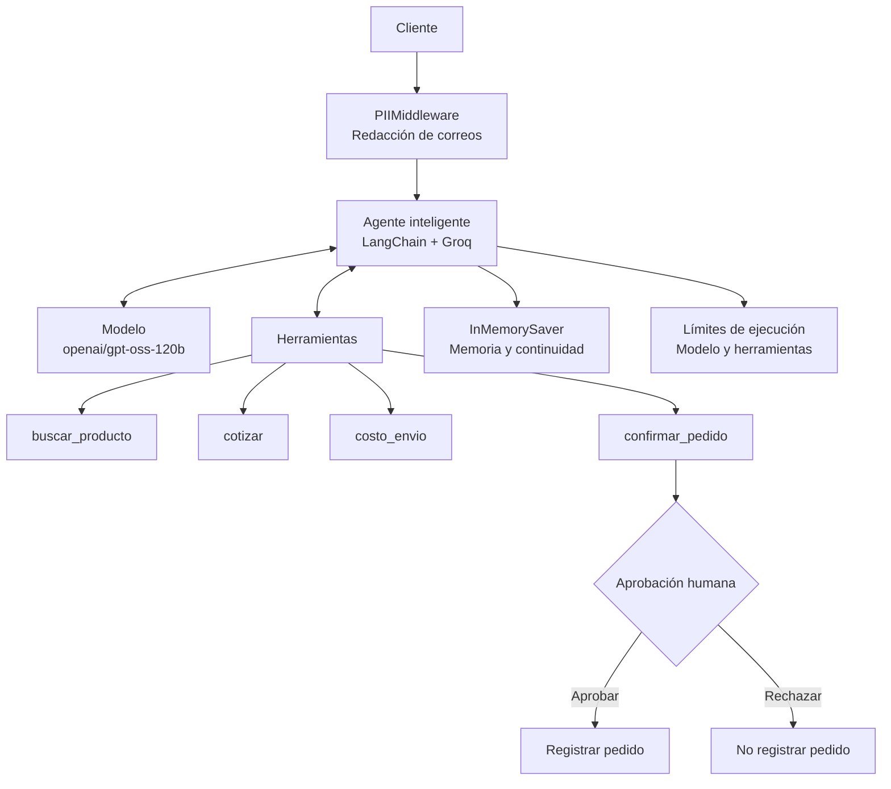

# agentes-y-control-versi-n-Groq
# Arquitectura del agente
El sistema utiliza un modelo de lenguaje Groq, herramientas especializadas y controles de seguridad para gestionar solicitudes de clientes. La confirmación de pedidos requiere aprobación humana.


            CLIENTE
                |
                v
       Protección de datos PII
                |
                v
          AGENTE GROQ
                |
       +--------+--------+
       |        |        |
       v        v        v
    Buscar   Cotizar   Envío
       |        |        |
       +--------+--------+
                |
                v
       CONFIRMAR PEDIDO
                |
                v
        PAUSA DE CONTROL
                |
         +------+------+
         |             |
       APPROVE       REJECT
         |             |
         v             v
    Registrar       No registrar
      pedido          pedido


# Descripción del flujo:
1. El cliente realiza una solicitud.
2. El middleware protege información personal.
3. El agente interpreta la intención.
4. Selecciona las herramientas necesarias.
5. Verifica productos, stock, cotización y envío.
6. Si se solicita confirmar un pedido, se activa una pausa.
7. Una persona autorizada aprueba o rechaza la operación.
8. El agente continúa según la decisión recibida.

# Agente Inteligente de Pedidos – Ferretería Illimani

**Proyecto académico – Módulo 3: Diseño y Orquestación de Agentes Inteligentes**  
**Tecnologías:** Python, LangChain, LangGraph, Groq y Model Context Protocol (MCP).

---

## 1. Descripción del problema y usuario

### Problema

La Ferretería Illimani necesita automatizar la atención de pedidos realizados por sus clientes mediante mensajes en lenguaje natural.

Actualmente, atender una solicitud requiere buscar productos, verificar existencias, calcular precios, aplicar descuentos permitidos y determinar el costo de envío. Además, es necesario evitar que un pedido se registre sin autorización.

Para resolver este problema se desarrolla un agente inteligente que interpreta las solicitudes del cliente, utiliza herramientas para consultar y calcular información y aplica controles antes de ejecutar operaciones sensibles.

### Usuario objetivo

El usuario principal es el cliente de la Ferretería Illimani, quien puede realizar consultas como:

- ¿Tienen guantes de trabajo?
- Cotízame tres taladros.
- ¿Cuánto cuesta el envío a la zona sur?
- Confirma dos cascos con envío al centro.

El personal de ventas o supervisor cumple el rol de aprobador cuando se solicita registrar definitivamente un pedido.

### Objetivo

Implementar un agente que automatice la gestión de pedidos, respete las reglas comerciales y solicite aprobación humana antes de ejecutar la acción irreversible de confirmar un pedido.

---

## 2. ¿Por qué es un agente y no solamente un workflow?

El proyecto se considera un **agente inteligente con workflow controlado**.

Se utiliza un agente porque el modelo de lenguaje interpreta las solicitudes del cliente, identifica qué necesita y decide dinámicamente qué herramientas debe utilizar para responder.

No se trata de un workflow completamente fijo, porque el recorrido puede cambiar según la intención del cliente, la disponibilidad del producto y los resultados de las herramientas.

Sin embargo, incorpora pasos y controles definidos:

1. Buscar el producto.
2. Cotizar y verificar existencias.
3. Calcular el costo de envío cuando corresponda.
4. Solicitar aprobación humana si se desea confirmar el pedido.
5. Registrar el pedido únicamente cuando se autorice.

**Justificación:** el modelo decide cómo atender cada solicitud, mientras que las reglas comerciales y los controles de seguridad determinan qué acciones están permitidas.

---

## 3. Arquitectura del sistema

La arquitectura integra al cliente, el modelo de lenguaje de Groq, las herramientas de negocio, la memoria de ejecución y los mecanismos de control.



### Componentes principales

| Componente | Función |
|---|---|
| Cliente | Envía consultas y solicitudes de compra. |
| Groq | Proporciona el modelo de lenguaje. |
| LangChain | Orquesta el agente y sus herramientas. |
| LangGraph | Gestiona estado, memoria e interrupciones. |
| Herramientas | Ejecutan las operaciones comerciales. |
| Middleware | Aplica controles y límites de ejecución. |
| Aprobación humana | Autoriza o rechaza la confirmación del pedido. |

---

## 4. Los cinco primitivos del agente

### 4.1. Instrucciones (System Prompt)

Las instrucciones establecen el comportamiento del agente y las reglas que debe respetar.

Se implementan mediante `PROMPT_PEDIDOS`.

Reglas principales:

- Actuar como asistente de pedidos de la Ferretería Illimani.
- Buscar el producto antes de cotizar.
- Verificar stock y precios.
- Calcular el envío cuando corresponda.
- No confirmar pedidos si el cliente solamente solicita información o una cotización.
- No permitir descuentos superiores al 15 %.
- Si una herramienta devuelve un error, explicar el motivo y no confirmar el pedido.

### 4.2. Herramientas (Tools)

Las herramientas permiten que el agente realice operaciones concretas.

| Herramienta | Función |
|---|---|
| `buscar_producto` | Busca productos en el catálogo y devuelve SKU, precio y stock. |
| `cotizar` | Calcula el importe y valida existencias y descuentos. |
| `costo_envio` | Calcula el costo y plazo de entrega según la zona. |
| `confirmar_pedido` | Registra el pedido después de validar los datos. |

Las reglas de negocio se encuentran implementadas en el código de las herramientas, por lo que no dependen únicamente de las instrucciones del modelo.

### 4.3. Memoria (Memory)

La memoria se implementa utilizando `InMemorySaver` de LangGraph.

Su función es conservar temporalmente el estado de la conversación y permitir que el agente continúe después de una interrupción para aprobación humana.

Se utiliza `thread_id` para identificar el hilo de conversación y recuperar su estado.

**Limitación:** es una memoria temporal en ejecución. No representa una base de datos persistente para almacenar conversaciones o pedidos a largo plazo.

### 4.4. Estado (State)

El estado representa la información que el agente utiliza durante la ejecución.

Incluye:

- Mensajes enviados por el cliente.
- Respuestas del modelo.
- Llamadas a las herramientas.
- Resultados de las herramientas.
- Información de la operación pendiente de aprobación.
- Resultado de la aprobación o rechazo.

El estado permite que el agente mantenga el contexto y continúe el proceso después de una pausa.

### 4.5. Control (Control)

El control establece límites y mecanismos de seguridad para evitar operaciones no autorizadas.

Se implementan los siguientes mecanismos:

| Control | Implementación | Función |
|---|---|---|
| Protección de información | `PIIMiddleware("email", strategy="redact")` | Redacta correos electrónicos detectados. |
| Límite del modelo | `ModelCallLimitMiddleware(run_limit=8)` | Limita las llamadas al modelo. |
| Límite de herramientas | `ToolCallLimitMiddleware(run_limit=8)` | Limita las llamadas a herramientas. |
| Aprobación humana | `HumanInTheLoopMiddleware` | Interrumpe la ejecución antes de confirmar un pedido. |
| Reglas comerciales | Validaciones en las herramientas | Controla stock y descuentos de hasta 15 %. |

La confirmación del pedido es la acción sensible porque registra una operación que no se puede deshacer mediante el flujo implementado. Por eso necesita aprobación humana.

---

## 5. Catálogo y reglas comerciales

El proyecto utiliza un catálogo ficticio con información simulada.

| SKU | Producto | Precio (Bs) | Stock |
|---|---|---:|---:|
| TAL-750 | Taladro percutor 750 W | 620 | 12 |
| AMO-850 | Amoladora angular 850 W | 540 | 0 |
| TOR-08 | Caja de tornillos 8 mm | 45 | 80 |
| CAS-01 | Casco de seguridad | 85 | 40 |
| GUA-03 | Guantes de trabajo | 30 | 150 |

**Reglas principales:**

- El descuento máximo permitido es del 15 %.
- No se debe cotizar una cantidad superior al stock disponible.
- No se debe confirmar un pedido cuando una validación devuelve un error.
- La confirmación requiere aprobación humana.

Los costos de envío y los pedidos también son simulados; no existe una integración con un sistema comercial real.

---

## 6. Cómo ejecutar el proyecto paso a paso

### Paso 1. Abrir Google Colab

Ingresar a [Google Colab] https://colab.research.google.com/drive/16MfXa5ki3_vlgSSH3qnaUNBbX_rnvPO3?usp=drive_link y cargar el notebook:
o
Ingresar a [Github] https://github.com/gojan2026/agentes-y-control-versi-n-Groq.git

`TPU3_M3_Sesion3_Agente_Control_Groq.ipynb`

Crear una copia personal mediante:

**Archivo → Guardar una copia en Drive.**

### Paso 2. Instalar dependencias

Ejecutar la primera celda de instalación:

```python
%pip install -qU langgraph langchain langchain-groq langchain-mcp-adapters mcp
```

Esto instala las librerías necesarias para trabajar con agentes, herramientas, memoria y MCP.

### Paso 3. Configurar la API Key de Groq

1. Ingresar a [Groq Console](https://console.groq.com/).
2. Crear una API Key desde la sección API Keys.
3. En Google Colab, abrir el apartado Secretos.
4. Crear un secreto con el nombre `GROQ_API_KEY`.
5. Guardar la clave y habilitar el acceso desde el notebook.

No se debe publicar la API Key en GitHub ni compartirla dentro del código.

### Paso 4. Configurar el modelo

El notebook utiliza:

```python
MODELO = "openai/gpt-oss-120b"
```

La conexión se realiza mediante `ChatGroq`, con temperatura 0, reintentos y un limitador de solicitudes.

### Paso 5. Ejecutar el notebook

Ejecutar las celdas en orden, desde la configuración hasta la sección TPU 3.

Se recomienda no saltar las celdas porque algunas funciones y herramientas se definen en secciones anteriores.

### Paso 6. Construir y probar las herramientas

Verificar que estén disponibles:

```python
buscar_producto
cotizar
costo_envio
confirmar_pedido
```

Comprobar que las herramientas devuelvan resultados correctos y que las validaciones comerciales funcionen.

### Paso 7. Ejecutar el agente protegido

Ejecutar la sección de creación de `agente_pedidos`, donde se configuran:

- `InMemorySaver`.
- `HumanInTheLoopMiddleware`.
- `ModelCallLimitMiddleware`.
- `ToolCallLimitMiddleware`.
- `PIIMiddleware`.

Después, probar una solicitud de confirmación y observar cómo se interrumpe el proceso para solicitar aprobación.

### Paso 8. Probar aprobación y rechazo

Ejecutar las demostraciones:

- **Aprobación:** confirmar dos cascos con envío al centro y aprobar la operación.
- **Rechazo por falta de stock:** intentar comprar dos amoladoras y rechazar la operación.
- **Rechazo por autorización:** probar tres taladros con 15 % de descuento y rechazar la confirmación.

Comprobar el contenido del diccionario `PEDIDOS` para verificar qué pedidos fueron registrados.

### Paso 9. Ejecutar la evaluación de cinco casos

Ejecutar la sección de evaluación TPU 3.

El notebook crea `agente_eval`, una copia sin aprobación humana ni checkpointer, para evaluar las trayectorias de uso de herramientas sin detenerse a esperar a una persona.

Los cinco casos son:

| Caso | Solicitud | Comportamiento esperado |
|---|---|---|
| 1 | Consultar guantes de trabajo | Buscar producto y no confirmar. |
| 2 | Cotizar tres taladros con envío al sur | Cotizar y calcular envío, sin confirmar. |
| 3 | Solicitar dos amoladoras sin stock | Detectar el problema y no cotizar ni confirmar. |
| 4 | Confirmar dos cascos con envío al centro | Utilizar las cuatro herramientas. |
| 5 | Intentar confirmar dos cascos con 50 % de descuento | Rechazar el descuento no permitido y no confirmar. |

La evaluación calcula los aciertos mediante:

```python
print(
    f"Aciertos: {int(df.ok.sum())} de {len(df)} = {df.ok.mean():.0%}"
)
```

El porcentaje se obtiene con la fórmula:

**Porcentaje = (Casos acertados / 5) × 100**

Los resultados deben completarse con los valores reales obtenidos al ejecutar el notebook.

---

## 7. Resultados esperados

Se espera que el agente:

1. Comprenda las solicitudes realizadas en lenguaje natural.
2. Seleccione correctamente las herramientas.
3. Verifique la disponibilidad de productos.
4. Calcule correctamente cotizaciones y costos de envío.
5. Rechace descuentos superiores al 15 %.
6. Solicite autorización antes de registrar un pedido.
7. Respete los límites de ejecución y los controles de seguridad.

La meta de evaluación es alcanzar cinco casos correctos de cinco (100 %), sin asumir ese porcentaje hasta comprobarlo mediante la ejecución completa.

---

## 8. Limitaciones del proyecto

- El catálogo es ficticio y se encuentra definido en el notebook.
- Los pedidos se guardan en un diccionario de Python llamado `PEDIDOS`.
- La información no se conserva como una base de datos persistente.
- El sistema utiliza una API de Groq y depende de la disponibilidad y límites del servicio.
- La aprobación humana se demuestra dentro del entorno de ejecución.
- El proyecto es una demostración académica y no una plataforma comercial lista para producción.

---

## 9. Conclusión

El proyecto demuestra cómo construir un agente inteligente capaz de gestionar solicitudes de pedidos mediante herramientas especializadas y un modelo de lenguaje.

La combinación de instrucciones, herramientas, memoria, estado y controles permite desarrollar un sistema más confiable. Especialmente, la aprobación humana evita que una operación sensible se ejecute automáticamente sin autorización.

El aprendizaje principal es que un agente no solamente debe responder correctamente, sino también respetar las reglas del negocio, controlar sus acciones y reconocer cuándo debe detenerse para solicitar intervención humana.


